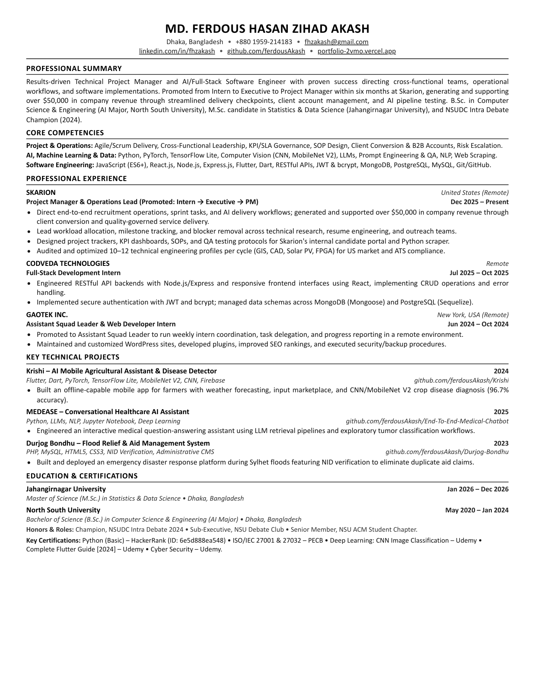
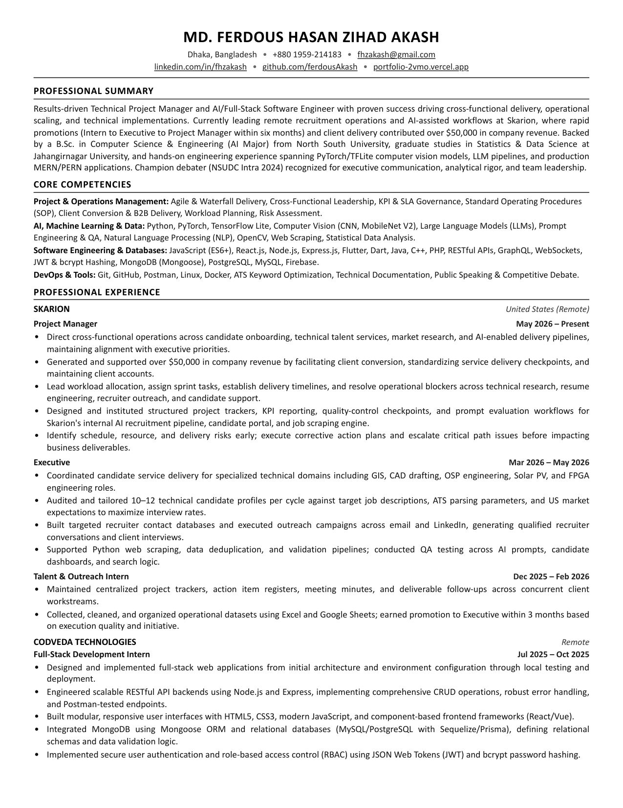
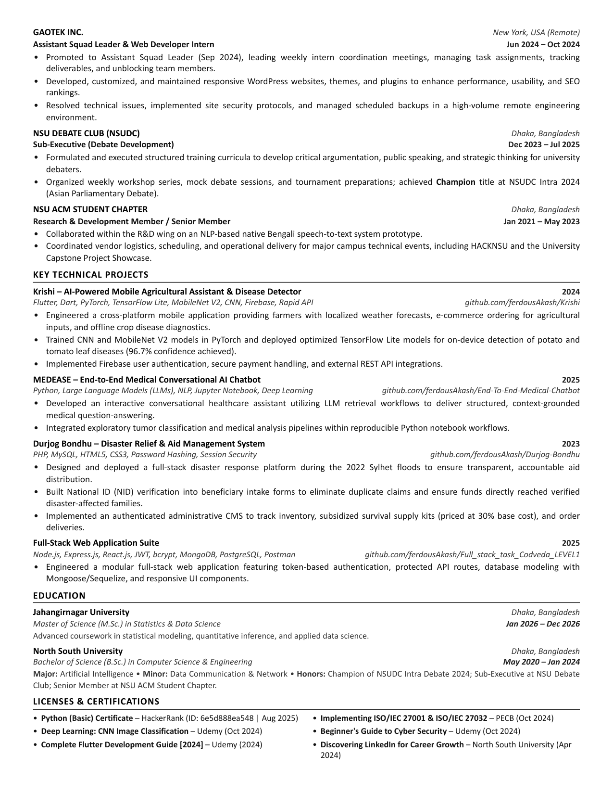

# Md. Ferdous Hasan Zihad Akash — ATS Resume

This directory contains the production, applicant tracking system (ATS) compliant resumes for **Md. Ferdous Hasan Zihad Akash**.

Designed to score 100% on automated parsing engines (Workday, Greenhouse, Lever, Taleo) with standard single-column typography, zero color distraction, standard section headings, and explicit metrics ($50K+ revenue, 3-tier promotion in 6 months, 96.7% AI detection accuracy, NSUDC 2024 Champion).

---

## Available Formats

| File | Type | Description |
| :--- | :--- | :--- |
| **[`Md_Ferdous_Hasan_Zihad_Akash_Resume.pdf`](./Md_Ferdous_Hasan_Zihad_Akash_Resume.pdf)** | PDF (2 Pages) | Comprehensive standard 2-page ATS resume covering all experience, projects, education, and certifications. |
| **[`Md_Ferdous_Hasan_Zihad_Akash_Resume_1Page.pdf`](./Md_Ferdous_Hasan_Zihad_Akash_Resume_1Page.pdf)** | PDF (1 Page) | High-density 1-page condensed ATS resume for fast-screen job applications. |
| **[`Akash_Resume_ATS.md`](./Akash_Resume_ATS.md)** | Markdown | Plain-text ATS format ready for direct copy-pasting into text application fields. |
| **[`Akash_Resume_ATS.html`](./Akash_Resume_ATS.html)** | HTML Source | Print-ready HTML source with strict print styles, Calibri font stack, and disabled ligatures. |
| **[`Akash_Resume_ATS_1Page.html`](./Akash_Resume_ATS_1Page.html)** | HTML Source | Print-ready HTML source for the 1-page layout. |

---

## Visual Previews

### 1-Page Edition

### 2-Page Edition
#### Page 1

#### Page 2

